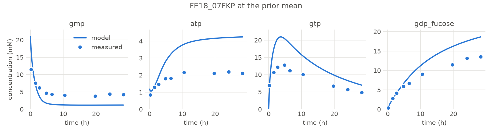
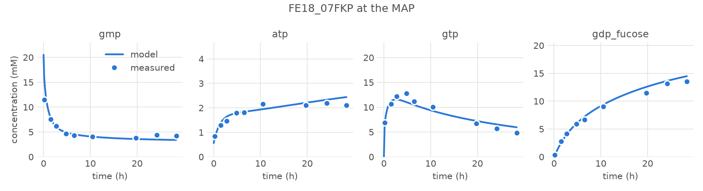

# Time courses

As well as finding and differentiating a kinetic model's steady state, enzax can also solve and differentiate initial value problems. This page demonstrates how, using the cell-free cascade in `enzax.examples.gdp_fucose`, which makes GDP-fucose from GMP, fucose and ATP. Huber et al. (2023) ran it in seven experiments, five for fitting and two for validation, each with its own enzyme loadings and starting amounts.

## The initial state

To run a time course enzax needs the initial amount of every balanced species. It looks for these amounts in a special parameter called `log_amount_initial`. To add the labels for `log_amount_initial` to a model's parameter labelling, use the function `get_initial_state_labelling` as follows:

```python
from jax import numpy as jnp

from enzax.examples import gdp_fucose
from enzax.time_course import get_initial_state_labelling

model = gdp_fucose.model
labelling = model.parameter_labelling | get_initial_state_labelling(model)
labelling["log_amount_initial"]
```

```
('pp', 'p', 'atp', 'adp', 'amp', 'fucose', 'fucose1p', 'gdp_fucose', 'gtp', 'gdp', 'gmp')
```

A species that starts at zero should have a fixed value of `-inf` in `log_amount_initial`, i.e. the logarithm of zero.

Time courses ignore the `moiety_totals` parameter as moiety totals are fixed by the initial amounts. Species in a rapid equilibrium need not start at equilibrium: the solve equilibrates them.

The initial amounts and enzyme loadings differ between the cascade's experiments, so `gdp_fucose.parameters` holds every experiment's values, with the labelling of `gdp_fucose.layout` (see [statistical modelling](statistical_modelling.md) for how experiments share parameters). `pick_experiment` gets one experiment's values, as required by the kinetic model:

```python
from enzax.experiments import (
    gather_parameters_by_experiment,
    pick_experiment,
)

params_by_experiment = gather_parameters_by_experiment(
    gdp_fucose.layout,
    gdp_fucose.parameters,
)
fe18_parameters = pick_experiment(
    gdp_fucose.layout,
    params_by_experiment,
    "FE18_07FKP",
)
jnp.exp(fe18_parameters["log_amount_initial"])
```

```
Array([ 0.  ,  0.  ,  6.  ,  0.18,  0.18, 25.7 ,  0.  ,  0.  ,  0.  ,
        0.  , 25.7 ], dtype=float64)
```

## Solving a time course

`get_measurables_time_course_single_experiment` solves one experiment from time 0 and returns whether the solve succeeded, then every species' concentration, every reaction's flux and every algebraic variable at each of the times it is given:

```python
from enzax.time_course import get_measurables_time_course_single_experiment

found, conc, flux, algebraic_variables = (
    get_measurables_time_course_single_experiment(
        model,
        fe18_parameters,
        jnp.exp(fe18_parameters["log_amount_initial"]),
        jnp.array([1.0, 5.0, 24.0]),
    )
)
conc[:, model.species.index("gdp_fucose")]
```

The solve integrates the model with diffrax's stiff solver `Kvaerno5`, solving any rapid equilibria and algebraic constraints at every step. Gradients go through the solver's steps. If a solve fails, `found` is `False` and the other outputs are computed at the initial state, so they are finite but meaningless.

`get_measurables_time_course_single_experiment_dae` takes the same arguments and returns the same things, but integrates the model as a differential algebraic equation with the BDF solver from [diffrax-bdf](https://github.com/dtu-qmcm/diffrax-bdf), a Python package which needs installing separately. For models with rapid equilibria or algebraic constraints it takes fewer steps than solving them at every step.

## Measurements over time

To represent time course measurements, first make a grid of named time points for each experiment, in the form of a map from labels to floating point times. Time points must increase in the order given:

```python
times = {"FE18_07FKP": {"11min": 0.183, "90min": 1.5, "164min": 2.73}}
```

A measurement object can name these time points after a `|` character in its `ids`:

```python
from enzax.measurements import LognormalMeasurement

gdp_fucose_measurement = LognormalMeasurement(
    experiment="FE18_07FKP",
    ids=["gdp_fucose|90min", "gdp_fucose|164min"],
    values=jnp.array([2.78, 4.19]),
    errors=jnp.array([0.1, 0.1]),
)
```

One measurement can cover several species and several time points. `gdp_fucose.load_measurements` builds the grids and the measurements for the cascade's data, labelling each time point by its minute. For statistical models of your own, `pick_concs_by_time` and `pick_fluxes_by_time` pick a measurement's predicted values out of a time course by id.

## Fitting time courses

`log_density_time_course` is the time-course counterpart of `log_density`. Besides the usual arguments it takes the time grids. Here four of the fitting experiments share their kinetic parameters, while each has its own enzyme loadings and initial amounts, in a simplified version of the setup in `case_studies/cascade/common.py`. The case study leaves out FE13, whose GDP-fucose curve alone supports a second posterior mode that predicts the validation experiments badly:

```python
from enzax.experiments import (
    get_experiment_layout,
    merge_experiment_parameters,
)
from enzax.parameter_split import (
    get_free_parameters,
    split_parameters_by_freeing,
)
from enzax.statistical_modelling import (
    log_density_time_course,
    prior_from_truth,
)

experiments = [e for e in gdp_fucose.FITTING_EXPERIMENTS if e != "FE13"]
layout = get_experiment_layout(
    labelling,
    experiments,
    gdp_fucose.EXPERIMENT_SPECIFIC,
)
expanded_parameters = merge_experiment_parameters(
    layout,
    [
        pick_experiment(gdp_fucose.layout, params_by_experiment, e)
        for e in experiments
    ],
)
split = split_parameters_by_freeing(
    layout.labelling,
    expanded_parameters,
    {
        "log_kcat": [r for r in gdp_fucose.KCAT if r != "PPA"],
        "log_saturation_constant": [
            "ki|FKP_fk|gdp_fucose",
            "km|UNKNOWN_HYDROLASE|amp",
            "km|PPK3_A|adp",
            "km|PPK3_A|atp",
            "km|PPK3_G|gdp",
            "km|PPK3_G|gtp",
            "km|PPK3|polyp",
            "km|PPK3_M|amp",
            "km|PPK3_M|adp",
        ],
        "dgf": ["atp", "gdp", "gmp"],
    },
)
free_parameters = get_free_parameters(split, expanded_parameters)
times, conc_measurements = gdp_fucose.load_measurements(experiments)
prior = prior_from_truth(free_parameters, sd=1.0)
saturation_loc, saturation_sd = prior["log_saturation_constant"]
prior["log_saturation_constant"] = (
    saturation_loc,
    saturation_sd.at[0].set(3.0),
)
prior["dgf"] = (
    free_parameters["dgf"],
    jnp.asarray(
        gdp_fucose.get_conditional_dgf_covariance(["atp", "gdp", "gmp"]),
    )
    + 2.0**2 * jnp.eye(3),
)
log_density_time_course(
    free_parameters,
    model,
    prior,
    times,
    layout=layout,
    split=split,
    conc_measurements=conc_measurements,
)
```

Only three formation energies are free: ATP's, GDP's and GMP's. The data constrain reactions' standard Gibbs energy changes, not compounds' formation energies, so the other nine are fixed at their prior means. Polyphosphate's stays fixed so that PPK3's equilibrium ATP/ADP ratio stays at the measured value of 3: left free, the fit lowers it to about 1.35, which suits the fitting experiments but stops Validation 1, with eight times the PPK3, from reaching its measured ATP. The prior on the free three is eQuilibrator's multivariate normal, conditioned on the fixed values, which `gdp_fucose.get_conditional_dgf_covariance` gives in the order the compounds are listed, with an extra 2 kJ/mol standard deviation on each, since eQuilibrator's estimates are not for the cascade's temperature, pH and Mg²⁺.

The layout must be made from a labelling that includes `log_amount_initial`, and a model with conserved moieties needs a split that fixes `moiety_totals`; the density raises otherwise. Concentration and flux measurements name time points in their ids; enzyme measurements do not, since enzyme levels do not change over time.

`get_measurables` chooses the solve: the default, `get_measurables_time_course_single_experiment`, or `get_measurables_time_course_single_experiment_dae`, either of them wrapped with `functools.partial` to change its options. Create it once and reuse it, since each new one is compiled anew. As with `log_density`, the density is NaN if any experiment's solve fails, and experiments are solved together with `jax.vmap`.

The figures below compare experiment FE18_07FKP's measurements with its time course at the prior mean and at the maximum a posteriori (MAP) estimate. The case study's log density adds more to the one above: each fitting experiment's FKP and PPK3 levels and initial amounts are free, measurements carry a bias for each measurement day, made with `LognormalMeasurement`'s `bias` field, GDP and GTP readings are calibrated, and a fraction of GDP-fucose is read as GMP. The curves show what the instrument would read: the time course with the calibration and the misreading applied, and at the MAP also multiplied by e to the power of its day's bias.

??? example "Code for these figures"

    ```python
    --8<-- "case_studies/cascade/docs_figures.py"
    ```

    `case_studies/cascade/mode.py` calls `plot_fit` with the prior mean and the MAP after fitting, and saves the figures: `cd case_studies/cascade && uv run --group plot python mode.py`.





`scripts/mcmc_demo.py` shows how to sample from a log density like this one. In the case study, `case_studies/cascade/mode.py` finds the MAP for the four fitting experiments and compares it with the two validation experiments, and `case_studies/cascade/fit.py` samples the posterior with NUTS, starting from the MAP.
